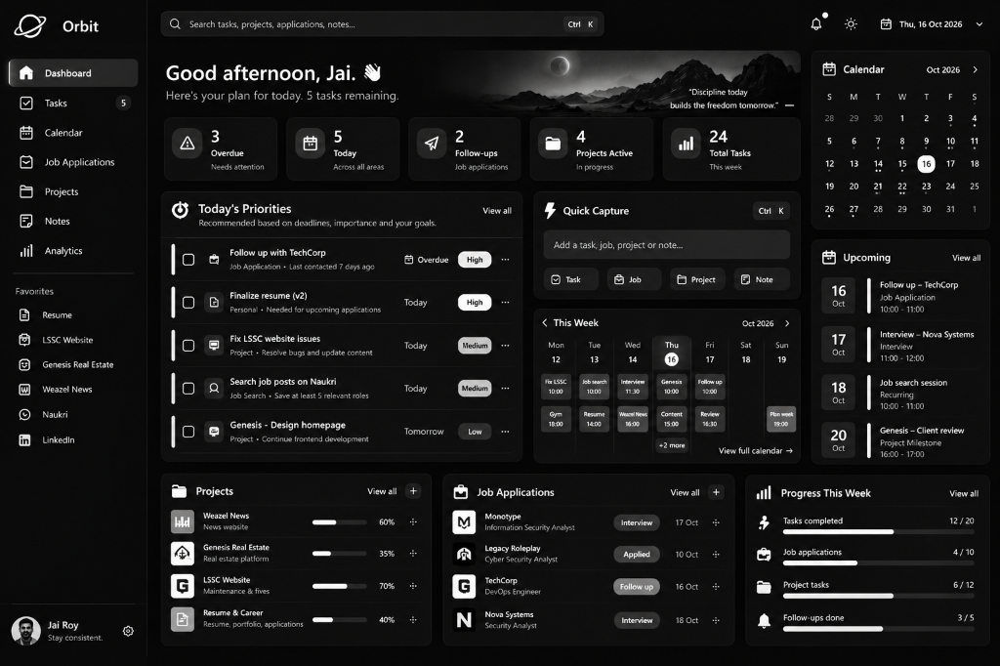
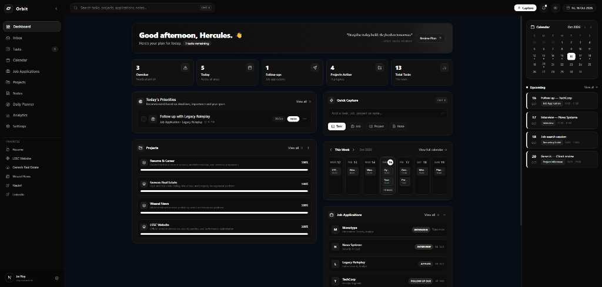

# 🪐 Orbit — Personal Productivity Command Center

<div align="center">



<p align="center">
  <b>A strict premium monochrome personal command center for high-output engineers and tech professionals.</b>
  <br />
  Combines task management, a calendar-based planner, a career application pipeline, and project workspaces into a unified dashboard.
</p>

[](https://nextjs.org/)
[](https://www.typescriptlang.org/)
[](https://tailwindcss.com/)
[](https://www.mongodb.com/atlas)
[](LICENSE)

</div>

---

## ⚡ The Purpose

Orbit is designed to answer three essential questions every morning:

1. **What needs my attention today?** — Identifies overdue tasks, urgent deadlines, and scheduled recruiter interactions.
2. **What should I prioritize next, and why?** — An explainable rules-based planning engine scores tasks and suggests priority items.
3. **What am I progressing toward across my career and projects?** — Tracks development workspaces and job interview pipelines with real-time velocity metrics.

---

## 📸 Application Snapshots

### 1. Dashboard Command Center (Live Preview)
The central command center features real-time KPI counters, today's ranked priorities, inline quick capture, a 7-day calendar preview, active project progress bars, and job application stages:



### 2. High-Fidelity Monochrome Design System
A strict, zero-color aesthetic engineered for distraction-free focus:


---

## 🎨 Strict Monochrome Design System

Orbit uses a curated **black-and-white grayscale palette** inspired by high-end engineering interfaces:

| Element | Token / Color | Usage |
| :--- | :--- | :--- |
| **Deep Background** | `#080808` | Near-black base canvas |
| **Panels & Surfaces** | `#111111` | Primary cards, sidebars, and modal containers |
| **Borders** | `#222222` / `#252525` | Subtle, accessible section dividers |
| **Primary Text** | `#F5F5F5` / `#FFFFFF` | High-contrast headers, metrics, and active items |
| **Secondary Text** | `#A3A3A3` / `#737373` | Context labels, timestamps, and subtitles |
| **Selected Dates** | `bg-white text-black` | Solid white circle indicator for today (16th) |
| **Priority: High/Critical** | `bg-white text-black` | Highest visibility badge for urgent commitments |
| **Priority: Medium** | `bg-[#262626] text-neutral-200` | Mid-tier contrast badge |
| **Priority: Low / Routine** | `bg-[#181818] text-neutral-400` | Subdued badge for secondary habits |
| **Progress Meters** | Pure White Fill | Contrast bar on dark track (`bg-[#1c1c1c]`) |

---

## 🚀 Core Features & Modules

### 1. Command Center Dashboard
- **Hero Landscape Banner**: Time-aware greeting (`Jai Roy`), motivational quote, and quick link to review today's plan.
- **Dynamic KPI Stat Cards**: Real-time calculated counters for Overdue items, Today's agenda, Recruiter Follow-ups, Active Projects, and Weekly Tasks.
- **Today's Priorities**: Ranked tasks displaying effort estimates, linked projects, and the explicit rationale explaining *why* each task was prioritized.
- **Quick Capture Card**: Instant capture with natural-language date parsing (`"tomorrow at 3pm"`, `"next monday"`) for Tasks, Jobs, Projects, and Notes.
- **Weekly Calendar Matrix**: Visual 7-day schedule with tasks rendered directly inside date chips.
- **Project Progress Tracker**: Workspace completion percentages calculated from linked deliverables.
- **Job Applications Queue**: Active status pipeline (`Interview`, `Applied`, `Follow up due`).
- **Weekly Velocity Stats**: Habit tracking and completion meters.

### 2. Task Management
- **Kanban Board**: Drag-and-drop workflow across `Inbox`, `To Do`, `In Progress`, `Blocked`, and `Done`.
- **List & Filter Views**: Instant filtering by Project, Priority (`Critical`, `High`, `Medium`, `Low`), and Status.
- **Task Modals**: Comprehensive scheduling including estimated effort hours, hard vs. flexible deadlines, consequences of delay, recurrence rules (`daily`, `weekdays`, `weekly`, `monthly`), and tags.

### 3. Career & Job Tracker
- **Pipeline Stages**: `Interested` ➔ `To Apply` ➔ `Applied` ➔ `Follow-up Due` ➔ `Interview` ➔ `Offer` ➔ `Rejected`.
- **Application Records**: Company, role, job post URL, source (LinkedIn, Naukri, Referral), salary notes, resume versions, and recruiter contacts.
- **One-Click Follow-Up Tasks**: Automatically schedules reminders without creating duplicates.
- **Interview Tracking**: Interview date scheduling, stage logging, and interview conversion metrics.

### 4. Development Workspaces
- Project hubs for multi-stage software projects:
  - **Weazel News** (Interactive media platform)
  - **Genesis Real Estate** (Property platform & virtual tours)
  - **LSSC Website** (Portal maintenance & security)
  - **Resume & Career** (Technical portfolio and resume iterations)
- Interactive milestone checklists, repository links, live preview URLs, and shared task tracking.

### 5. Schedule & Calendar
- Unified **Month**, **Week**, and **Day** views.
- Category filters to isolate Project deadlines, Career interviews, or Habits.
- Day Agenda drawer displaying scheduled time slots and effort estimates.

### 6. Notes & Knowledge Base
- Documentation workspace supporting Markdown formatting, technical snippets, and tags.
- Pin important notes to top and link notes directly to projects or job applications.

### 7. Daily Planning Engine
- **Explainable Scoring Algorithm**: Prioritizes tasks based on hard deadlines, overdue status, delay penalties, and recruiter follow-up urgency.
- **Capacity Meter**: Real-time warning gauge when planned tasks exceed your daily capacity hours.
- **Anti-Procrastination Review**: Detects tasks postponed multiple times and guides rescheduling or cancellation.

---

## ☁️ Database & Persistence Architecture

Orbit features a dual-layer persistence model:

1. **MongoDB Atlas Cloud Database**:
   - Connection URI: `mongodb+srv://...`
   - Collections: `tasks`, `projects`, `jobapplications`, `notes`, `preferences`
   - Dedicated Next.js Route Handlers (`/api/tasks`, `/api/projects`, `/api/jobs`, `/api/notes`, `/api/preferences`, `/api/seed`)
   - Schema validation with Mongoose models.

2. **Offline-First Hybrid Sync**:
   - Synchronizes cloud database records with local storage for instant page loads.
   - Manual sync triggers, full JSON backup export, and JSON file restore in Settings.

---

## 🛠️ Technology Stack

- **Framework**: [Next.js 16](https://nextjs.org/) (App Router & Turbopack)
- **Language**: [TypeScript](https://www.typescriptlang.org/)
- **Database**: [MongoDB Atlas](https://www.mongodb.com/atlas) via [Mongoose](https://mongoosejs.com/)
- **Styling**: [Tailwind CSS v4](https://tailwindcss.com/) with strict monochrome tokens
- **Icons**: [Lucide React](https://lucide.dev/)
- **Date Utilities**: Date-fns

---

## 📦 Getting Started

### 1. Clone Repository
```bash
git clone https://github.com/Jairoy2426/Orbit.git
cd Orbit
```

### 2. Install Dependencies
```bash
npm install
```

### 3. Configure Environment Variables
Create a `.env.local` file in the root directory:
```env
MONGODB_URI=mongodb+srv://<username>:<password>@orbit.gswkaub.mongodb.net/orbit?retryWrites=true&w=majority
```

### 4. Run Development Server
```bash
npm run dev
```
Open [http://localhost:3000](http://localhost:3000) in your browser.

### 5. Build for Production
```bash
npm run build
npm run start
```

---

## 👤 Author

**Jai Roy**
- GitHub: [@Jairoy2426](https://github.com/Jairoy2426)
- LinkedIn: [Jai Roy](https://www.linkedin.com)

---

## 📄 License

This project is licensed under the [MIT License](LICENSE).
